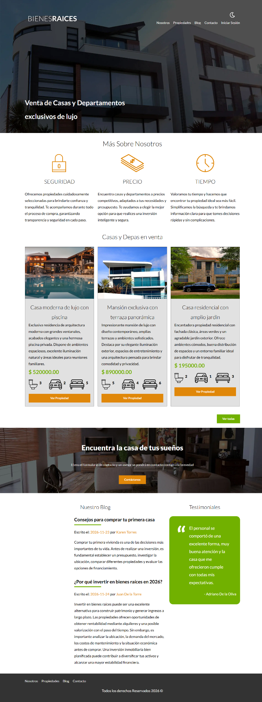
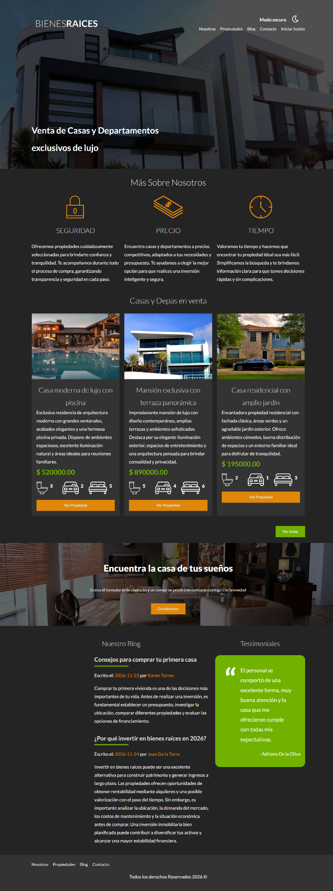
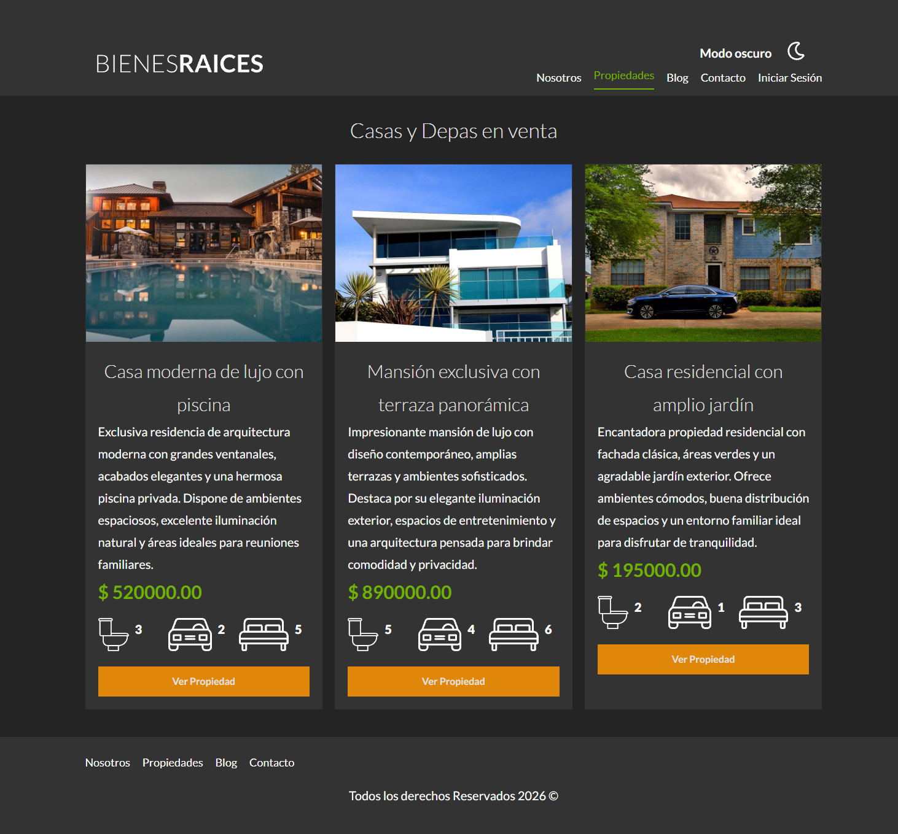
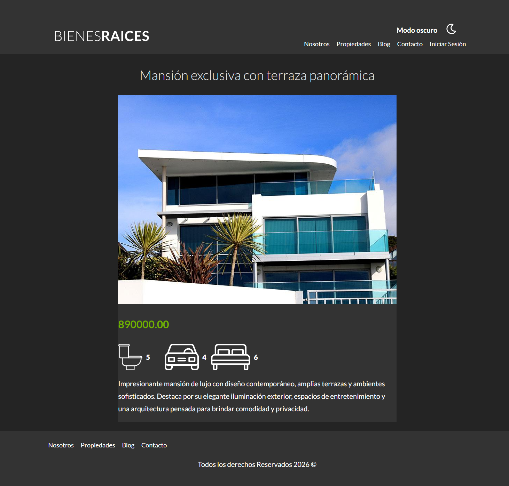
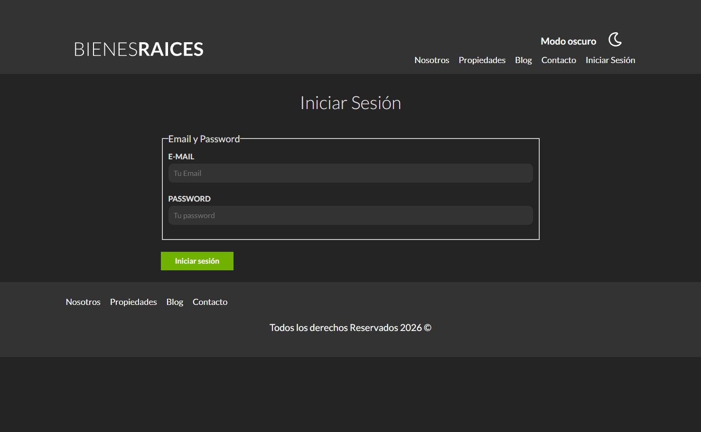
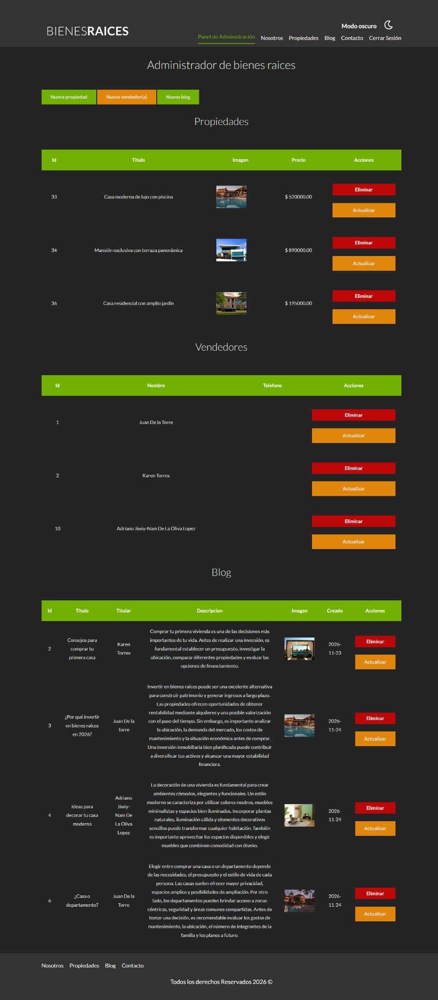
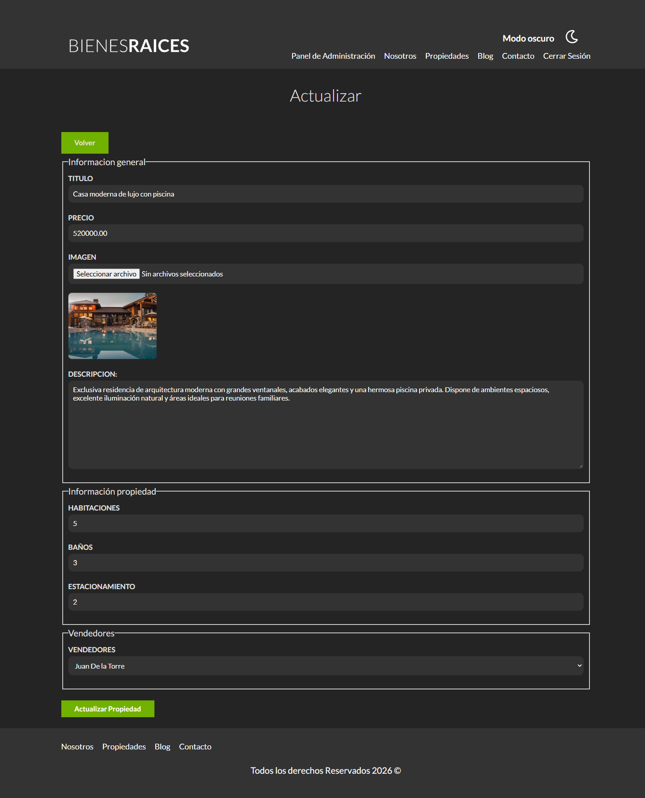
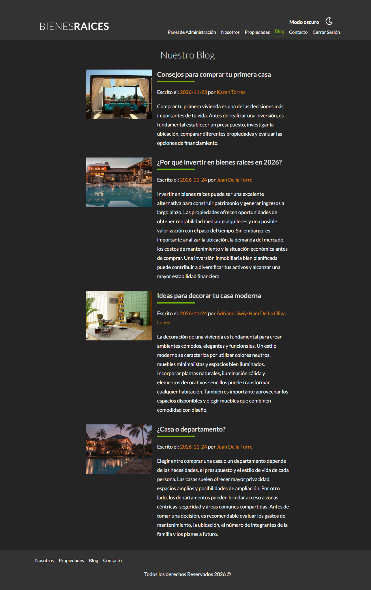
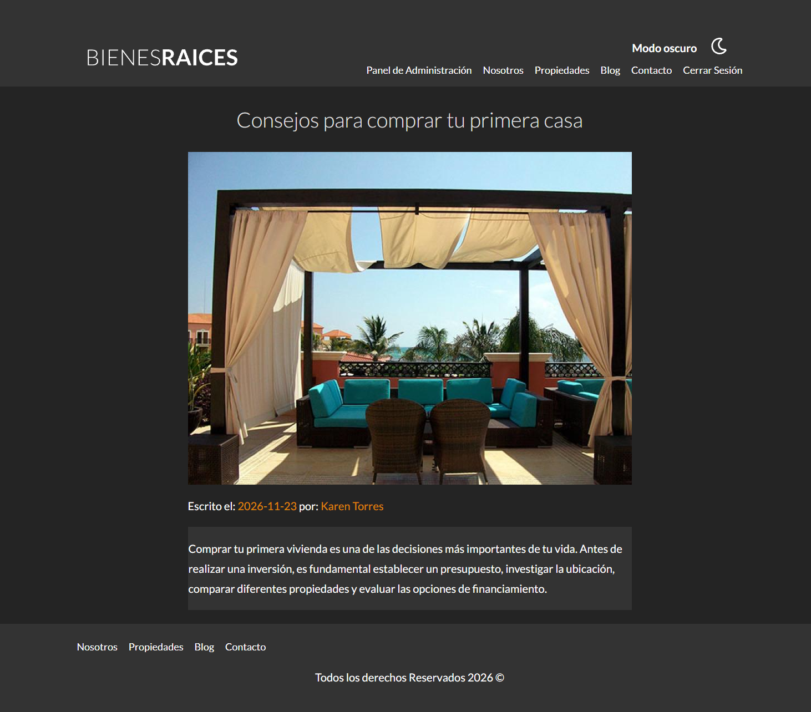
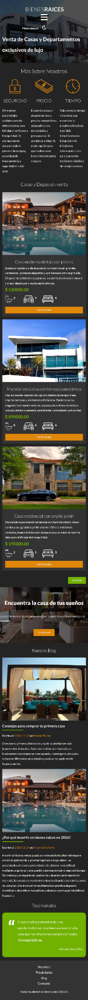

# 🏡 Bienes Raíces — Full Stack Web Application

Plataforma web inmobiliaria desarrollada bajo la arquitectura MVC, orientada a la publicación y gestión de propiedades, vendedores y contenido inmobiliario.

## 🌐 Demo en producción

[Visitar aplicación web](https://bienesraices-production-3baa8f6c.up.railway.app/)

## 🚀 Funcionalidades

- Catálogo de propiedades inmobiliarias.
- Panel de administración.
- Autenticación de usuarios.
- Protección de rutas administrativas.
- CRUD de propiedades, vendedores y publicaciones.
- Diseño responsive.
- Modo oscuro dinámico.
- Animaciones CSS.
- Barra de navegación fija con animaciones.
- Navegación interactiva con indicador de página activa.

## 🛠️ Tecnologías utilizadas

### Frontend

- HTML5
- CSS3
- SASS / SCSS
- JavaScript
- Gulp

### Backend

- PHP 8.3
- Arquitectura MVC
- Composer
- PDO
- PostgreSQL

### Infraestructura y despliegue

- Git y GitHub
- Docker
- Apache
- Railway
- Neon Database

## 🏗️ Arquitectura

El proyecto implementa el patrón MVC (Modelo, Vista y Controlador), permitiendo separar la lógica de negocio, la interfaz de usuario y el acceso a la base de datos, facilitando el mantenimiento y la escalabilidad de la aplicación.

## ☁️ Despliegue en la nube

La aplicación se encuentra desplegada en Railway mediante Docker y utiliza una base de datos PostgreSQL alojada en Neon.

La integración con GitHub permite gestionar el control de versiones y automatizar el despliegue de nuevas actualizaciones.

## 📚 Aprendizajes del proyecto

- Implementación de la arquitectura MVC.
- Migración de MySQL a PostgreSQL.
- Conexión a bases de datos mediante PDO.
- Gestión de variables de entorno.
- Autenticación y protección de rutas.
- Contenedorización de aplicaciones con Docker.
- Despliegue de aplicaciones Full Stack en la nube.
- Manipulación del DOM mediante JavaScript.
- Animaciones mediante Keyframes y transiciones CSS.
- Automatización de tareas mediante Gulp.
- Control de versiones con Git y GitHub.

## 📸 Capturas del proyecto

### Página principal — Light & Dark Mode

| Modo claro | Modo oscuro |
| :---: | :---: |
|  |  |

### Catálogo de propiedades

### Detalle de propiedad

### Autenticación

Panel administrativo y operaciones CRUD

### Panel administrativo

### Actualización de propiedades

Blog inmobiliario

### Listado de publicaciones

### Detalle de publicación

### Diseño responsive

  

## 👨‍💻 Sobre el proyecto

Proyecto desarrollado con el propósito de fortalecer conocimientos de desarrollo Full Stack, arquitectura de software, bases de datos relacionales y despliegue de aplicaciones web en entornos de producción.